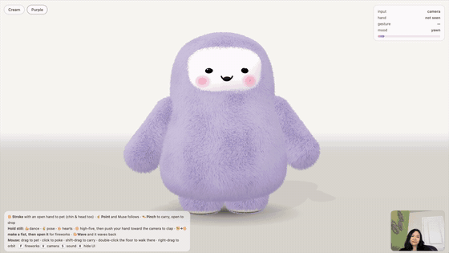
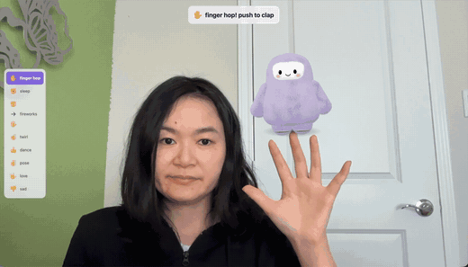

# Muse Pet

Two hand-tracked toys in the browser starring the fuzzy Muse mascot (three.js strand-fur shading + MediaPipe hand tracking):

- **Muse Pet** (pet it, carry it, fireworks): https://sophiamyang.github.io/muse-pet/
- **Muse, on your hand (AR)** (your webcam is the screen, Muse sits on your hand): https://sophiamyang.github.io/muse-pet/ar.html

Both run entirely in your browser; the camera video never leaves your computer. Click **Start camera** to begin.

## Muse Pet

**Try it:** https://sophiamyang.github.io/muse-pet/ (or open `index.html` in Chrome). Click **Start camera**, or **Use mouse**.

### Gestures

| Gesture | Reaction |
|---|---|
| 🖐 Stroke over Muse with an open hand | Petting: squish, purr, hearts (chin scratch and head pat have their own reactions) |
| ☝️ Point | Walks along the floor to stand under your fingertip |
| 🤏 Pinch over it | Pick up and carry; open your fingers to drop |
| 👍 hold | Happy dance |
| ✌️ hold | Strikes a pose and winks |
| 🤟 hold | Burst of hearts |
| ✋ hold still | Muse raises a paw for a high-five; push your hand toward the camera to clap (hearts + hop) |
| ✊ → 🖐 make a fist, then open it | Fireworks burst where your hand is; the room goes dark, Muse cheers and hops |
| 👋 Wave (not over Muse) | Waves back |
| Leave it alone ~20 s | Naps, wakes when you return |

Held gestures trigger after about half a second of holding still, with the palm facing the camera.

Mouse: drag to pet, click to poke, shift-drag to carry, double-click the floor to walk there, right-drag to orbit. Keys: `F` fireworks, `V` camera preview, `S` sound, `H` hide UI.

## Muse, on your hand (AR)

**Try it:** https://sophiamyang.github.io/muse-pet/ar.html (or open `ar.html` in Chrome). Click **Start camera**.

Your webcam becomes the screen and Muse sits on your hand, following it around. Hold a pose for about a third of a second; the pose name lights up at the top and in the list on the left.

| Pose | Muse |
|---|---|
| ✋ Open palm | Hops from fingertip to fingertip, index to pinky and back; push your hand toward the camera to clap (hearts + hop) |
| ✊ Fist | Curls up on your knuckles and falls asleep (Zzz) |
| ✊ → 🖐 Fist, then open your hand | Fireworks! The room goes dark and Muse cheers |
| ☝️ Point up | Balances on your fingertip and twirls, sparkling |
| 👍 Thumbs up | Dance party on your thumb, with music notes |
| ✌️ Peace sign | Strikes a pose and winks |
| 🤟 Love-you sign | Showers of hearts and a big blush |
| 👎 Thumbs down | Sulks under its own little rain cloud |
| Hand away | Drops to the floor and waits |

Keys: `H` hide UI, `S` sound.

## Built with

[three.js](https://threejs.org) and [MediaPipe Gesture Recognizer](https://ai.google.dev/edge/mediapipe/solutions/vision/gesture_recognizer), both loaded from CDN.
